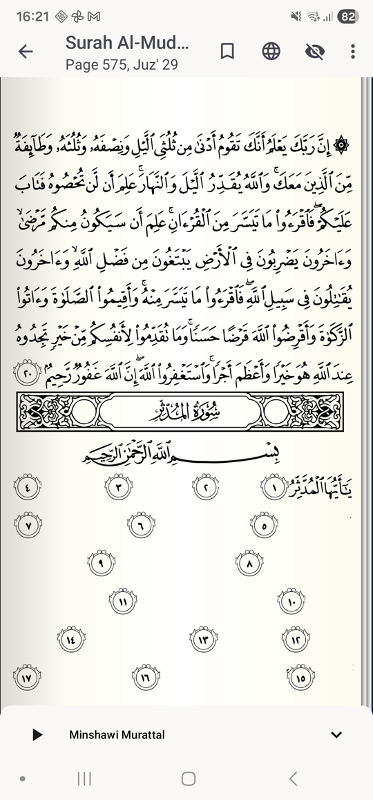
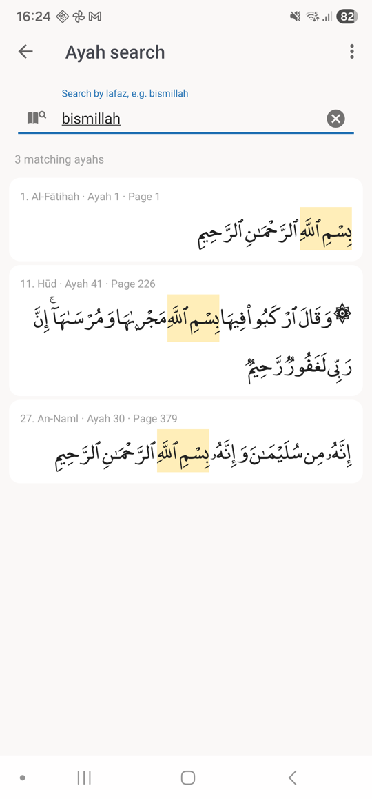
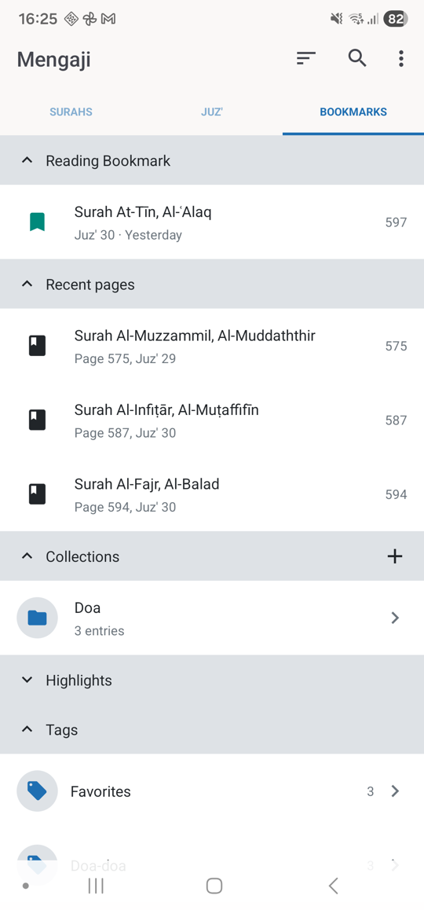

# Mengaji

**A calm Quran companion for reading, listening, and memorizing.**

Mengaji is a free, open-source Quran app for Android. It is a fork of the
excellent [Quran for Android](https://github.com/quran/quran_android) project,
with a focus on daily reading and hifz.

  
  
  

  <b>Hifz mode</b> · <b>Ayah search</b> · <b>Collections</b>

## Made for everyday Quran time

Mengaji keeps the focus on the Quran: beautiful pages, a quiet reading
experience, and tools for learning that stay out of the way.

### Read

- Beautiful Madani page images.
- Translations and tafsir in many languages.
- Light, dark, and sepia page themes.
- Adjustable Arabic and translation text sizes.
- Page numbers, surah names, and juz' information while reading.

### Memorize with Hifz mode

Hifz mode covers the ayahs on a page so you can recite from memory, then reveal
them as you go.

- **Per ayah:** tap an ayah to reveal or hide it.
- **Word by word:** reveal a little more with each long press.
- **Per page:** reveal from the beginning of the page, or swipe to move through
  ayahs one at a time.
- **First words only:** show just the beginning of every ayah as a prompt.
- Keep ayah number markers visible while the text is hidden.

Tap the Hifz icon in the reader to begin, and long-press it for more options.

### Find the ayah you remember

Ayah search is powered by [Lafzi](https://github.com/lafzi/lafzi-android) and
lets you search by how an ayah sounds:

- Type a transliteration such as `bismillah`.
- Or type the ayah in Arabic.
- Matching words are highlighted in the results.
- Tap a result to open it directly in the reader.
- Show or hide translations in the search results from the overflow menu.

Open **Ayah search** from the home screen menu.

### Keep your place

- **Reading bookmarks** remember where you stopped.
- **Recent pages** help you return to what you were reading.
- Bookmark pages and ayahs for later.
- Highlight ayahs in five colors.
- Reading bookmarks, recent pages, collections, highlights, and tags all live
  together in the **Bookmarks** tab.

### Organize your study

**Collections** are named lists of ayah ranges, perfect for a daily wird, a
class, or a memorization plan.

- Create a collection, add ayah ranges from the ayah sheet, and reorder entries.
- Open an entry to return to its ayah range in the reader.
- Read a collection as a dedicated list, with optional translations and a
  continuous, page-like Arabic layout.
- **Tags** work alongside collections for labels that cut across different
  parts of your reading.

Open Collections from the **Bookmarks** tab and tap **+** to start one.

### Listen

- Recitations from several reciters.
- Repeat and playback speed controls.
- Stream or download audio for offline listening.
- Control playback from the reader with the built-in audio bar.

### Make it yours

- Arabic and translated interfaces.
- App and page themes.
- Translation and tafsir choices.
- Volume-key page navigation and other reading preferences.

## Download

Get the latest version from the
[releases page](https://github.com/xaepudin/mengaji/releases/latest).

Mengaji runs on Android 7.0 and newer.

## A note on the original project

Mengaji exists because of the wonderful work of the
[Quran for Android](https://github.com/quran/quran_android) team and its
contributors. All credit for the original app, its data, translations, and
infrastructure belongs to them.

The main additions in this fork are **Hifz mode**, **Lafzi-powered ayah
search**, and **collections**.

## Credits

- Original project: [Quran for Android](https://github.com/quran/quran_android)
  by the Quran.com team and its
  [contributors](https://github.com/quran/quran_android/blob/main/CONTRIBUTORS.md).
- Ayah search index from [Lafzi](https://github.com/lafzi/lafzi-android) and
  [lafzi-indexer](https://github.com/lafzi/lafzi-indexer).
- `me_quran.ttf`, used for search results and collection reading text, comes
  from the [Lafzi](https://github.com/lafzi/lafzi-android) project.
- Madani images from the
  [quran images project](https://github.com/quran/quran.com-images) on GitHub.
- Qaloon images used with permission of Nous Memes Editions Et Diffusion
  (Tunisia).
- Naskh images used with permission of SHL Info Systems.
- Translation, tafsir, and Arabic data come from
  [quranenc](https://quranenc.com) and
  [King Saud University](https://quran.ksu.edu.sa). A small number of
  translations also come from [tanzil](http://tanzil.net).

May Allah reward all the awesome contributors and translators of the original
project.

## Contributing

Bug reports and feature ideas are welcome in
[Issues](https://github.com/xaepudin/mengaji/issues).

For build and release instructions, see [DEVELOPING.md](DEVELOPING.md).

## License

GNU General Public License v3.0 — see [LICENSE](LICENSE).

Please keep use of this code for non-profit purposes only. The data is licensed
under the licenses of the data's authors (typically
[CC BY-NC-ND](https://creativecommons.org/licenses/by-nc-nd/2.0/), but may
differ depending on the source of the data).
